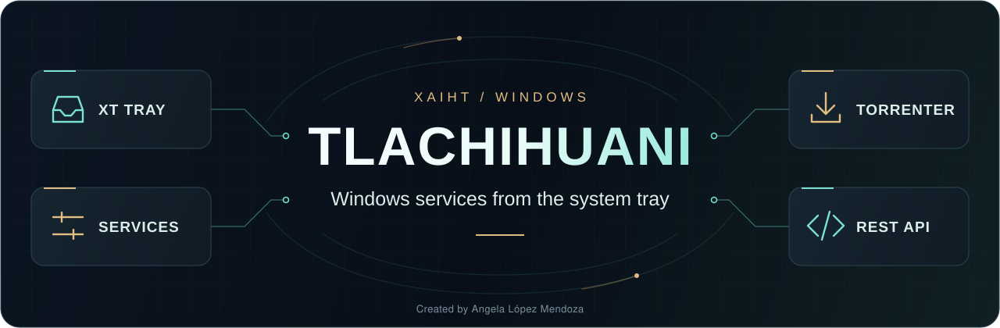

<!-- Tlachihuani — Created for Angela López Mendoza · XAIHT · @angelahack1 -->

<p align="center">
  
</p>

<h1 align="center">Tlachihuani</h1>

<p align="center">
  <b>Start your Windows services from the XT tray. Follow your downloads in Tlamatini.</b><br />
  Tlachihuani runs background jobs independently of your browser and chat windows.
  Torrenter is its first provider.
</p>

<p align="center">
  <a href="docs/releases/v0.2.1.md"></a>
  <a href="#installation"></a>
  <a href="packaging/setup/README.md"></a>
  <a href="#build-from-source"></a>
  <a href="docs/torrenter.md"></a>
</p>

<p align="center">
  <b>Latest released version: <a href="docs/releases/v0.2.1.md">v0.2.1</a></b><br />
  <b>Offline installer &amp; uninstaller · Bundled runtimes · Control Panel removal</b><br />
  Illustrated setup guide · SHA-256 checksums · Optional XT at sign-in · Desktop shortcut
</p>

<p align="center">
  <a href="docs/releases/v0.2.1.md">What's new in 0.2.1</a> ·
  <a href="#installation">Install &amp; uninstall</a> ·
  <a href="packaging/setup/README.md">Package guide</a> ·
  <a href="#first-download">First download</a> ·
  <a href="#tray-controls">Tray controls</a> ·
  <a href="#documentation">Documentation</a>
</p>

> [!TIP]
> **Already installed?** Right-click **XT → Start Services**. When the icon turns color, open **Panels → Torrenter Workspace** in Tlamatini to see the downloads for your signed-in account.

If XT is missing after setup, open **Tlachihuani XT** from Start or press **Win+R** and run `"C:\Program Files\XAIHT\Tlachihuani\Tray\Tlachihuani.Tray.exe" --show`. The overview can show **Stopped** on first launch. Right-click the gray XT icon beside the clock (check the hidden icons), then choose **Start Services**. The [local health endpoint](http://127.0.0.1:12064/api/v1/health) should return `{"api_version":1,"engine":"ready"}`.

## First download

1. **Open your workspace.** Use the Tlamatini menu above, or choose **Open workspace** in XT. If both Tlamatini editions are available, choose the account you want to use.
2. **Pick what to download.** Select **Add torrent**, paste a magnet or open a `.torrent` file, then choose **Inspect metadata**. Jobs can look up four magnets at once. Additional magnets wait in order, and their peer timeout starts when a slot opens.
3. **Start the transfer.** Choose the files you want and select **Download selected files**. You can close the browser or Tlamatini while the Jobs service continues downloading.
4. **Find your files.** Select the completed transfer and open **Verified output** for its saved directory and each file’s SHA-256. The usual destination is **Downloads → Torrenter**. If Windows refuses delivery there, check Verified output for the application’s `content_generated` fallback.

## Tray controls

| What you want to do | Where to go | What happens |
| :--- | :--- | :--- |
| Bring Torrenter online | **XT → Start Services** | The icon turns color when the services and API are ready. |
| Check a slow download | **XT → Show panel → Services…** | Inspect Jobs, engine and web readiness. Open the workspace for the transfer’s progress, trackers and peers. |
| Stop background work | **XT → Stop Services** | The services and their workers stop. The gray XT icon stays available to start them again. |
| Close only the tray | **XT → Exit tray** | The icon disappears. If a service is running, the menu reads **Exit tray (service keeps running)**. |

> [!NOTE]
> **Remove record** keeps the downloaded files. To delete the files themselves, choose **Erase files…**, review the exact files and approve the operation in XT.

## Installation

Use **Windows 11 x64**. The download includes private .NET and Python runtimes; no SDK or separate runtime installation is required. Windows runs two independent services. `Tlachihuani` reports lifecycle and health. `Tlachihuani.Jobs` hosts Torrenter. The XT tray runs in the signed-in Windows session.

### Install with the Windows wizard

1. Get **Tlachihuani-0.2.1-windows-x64.zip** from your distributor. Right-click it → **Extract All**, then open **START-HERE.html** for the offline illustrated guide. The release command produces the ZIP in `dist\`.
2. Sign in as the Windows user who will operate XT. Open **Installer.exe** and choose whether **XT should appear at Windows sign-in**. This choice applies to all Windows users on the PC. Select **Review**, check the version, operator, destination and startup choice, then choose **Install** and approve Windows' administrator prompt.
3. After **Installation complete**, XT appears gray in your normal Windows session. Check the hidden-icons arrow beside the clock. **Start menu and Desktop shortcuts** always let you reopen it. If the entire wizard was launched as administrator, open XT from either shortcut yourself.
4. Choose **Start Services** only when needed. Both services remain **Stopped / Manual** after installation and reboot. Login opens XT only when you selected that option; it never starts services or downloads. With the option unchecked, open XT manually after signing in.

### Uninstall and keep your downloads

1. In XT, choose **Stop Services**, wait for the icon to turn gray, then choose **Exit tray**. Close XT in other signed-in sessions too.
2. Open **Control Panel → Programs → Programs and Features → Tlachihuani → Uninstall**. Windows **Settings → Apps → Installed apps** and **Uninstall Tlachihuani** in Start provide the same registered removal. The matching **Uninstaller.exe → Review → Uninstall** is also included. Approve the Windows prompt.
3. Your delivered files and the protected Jobs state stay on disk. Reinstall with the same Windows operator to reuse the retained identities and journal. If the wizard requests a restart, restart Windows before reinstalling.

**Already installed with PowerShell?** Those installations use a separate maintenance path. Follow the [Windows packaging guide](packaging/windows/README.md) for the primary service and the [Jobs operating guide](docs/torrenter.md#windows-installation) for Jobs. The wizard refuses to take ownership of a legacy installation.

See the [setup guide](packaging/setup/README.md) for prerequisites, recovery, logging and visible acceptance tests.

### Build from source

**Create the complete distributable from Command Prompt at the repository root:**

```bat
Build-Release.cmd
```

Or run `.\Build-Release.cmd` in a visible PowerShell console. Each run reads the highest numeric local `vX.Y.Z` release tag, stamps the product and internal project references, rebuilds the four components and installer, and verifies the package before writing **`dist\Tlachihuani-<version>-windows-x64.zip`** and **`.zip.sha256`**. Upload those two files to your GitHub Release. The script never commits, creates tags or uploads anything.

The current checkout, including local edits, supplies the code; the tag supplies its version. Keep your local tags current. Prerelease tags are ignored, and a highest release tag outside the checkout's history stops the build. Fresh staging prevents old published files from leaking into a new ZIP. Build logs and source provenance stay under `artifacts/release-builds/`. See the [release command guide](docs/release-building.md) for prerequisites and acceptance checks.

<details>
<summary><b>Show PowerShell commands and runtime requirements</b></summary>

Use the SDK pinned in [global.json](global.json). Open a visible foreground PowerShell console and keep it open for the results. From the source checkout on this machine, run:

```powershell
Set-Location -LiteralPath 'C:\Development\XAIHT\Tlachihuani'
.\scripts\Build.ps1 -Mode Check
.\scripts\Build.ps1 -Mode Publish
.\scripts\Build-Setup.ps1
.\artifacts\publish\Control\Tlachihuani.Control.exe status
.\artifacts\publish\Tray\Tlachihuani.Tray.exe --show
```

These lower-level commands are for component development. **Check** exercises the lifecycle boundaries. **Publish** produces the four self-contained x64 components under `artifacts/publish/`. **Build-Setup** packages those published bytes. Use **Build-Release.cmd** above for a fresh, verified distributable in `dist`. The current build is unsigned; a publisher certificate is required for Authenticode signing.

</details>

## Documentation

| For operators | For developers |
| :--- | :--- |
| [Torrenter workspace and REST API](docs/torrenter.md) | [Architecture and process responsibilities](docs/architecture.md) |
| [Service lifecycle](docs/lifecycle.md) | [Controller commands and JSON replies](docs/control-protocol.md) |
| [Panel and tray](docs/panel-and-tray.md) | [Tlamatini integration design](docs/tlamatini-integration.md) |
| [Windows privileges and local IPC](docs/security-and-installation.md) | [Implementation status and verification evidence](docs/implementation-status.md) |

<details>
<summary><b>Under the hood · API, repositories and contributor references</b></summary>

The browser workspace and Tlamatini’s wrapped Torrenter agent use the same account-scoped Jobs API. With Jobs running, [open local API discovery](http://127.0.0.1:12064/api/v1). The native controller handles `status`, `events [--cursor N]`, `start`, `stop` and `restart` for the primary service. The separate **Panels → Tlachihuani** lifecycle panel is a design target. **Panels → Torrenter Workspace** is the implemented download interface.

| Reference | Location |
|---|---|
| This independent project | `C:\Development\XAIHT\Tlachihuani` |
| Tlachihuani on GitHub | [github.com/angelahack1/Tlachihuani](https://github.com/angelahack1/Tlachihuani) |
| Tlachihuani Git origin | `https://github.com/angelahack1/Tlachihuani.git` |
| Tlamatini source checkout | `C:\Development\XAIHT\Tlamatini` |
| Tlamatini Django application | `C:\Development\XAIHT\Tlamatini\Tlamatini` |
| Tlamatini on GitHub | [github.com/XAIHT/Tlamatini](https://github.com/XAIHT/Tlamatini) |
| Verified origin | `https://github.com/XAIHT/Tlamatini.git` |
| Design reference revision | `c18d50815cfe8b1681f805fd4e76c66fbaeabaf6` (`v1.78.0-4-gc18d5081`) |

For the next development session, read [AGENTS.md](AGENTS.md), [CLAUDE.md](CLAUDE.md) and the [session handoff](NEXT_SESSION.md). The [roadmap](docs/implementation-plan.md), [verification plan](docs/verification-plan.md), [project tree](docs/project-tree.md), [source review](docs/source-review.md) and [skill inventory](docs/skill-inventory.md) cover the rest of the checkout. Changes to either repository and publication require their own authorization.

</details>

<p align="center">
  <a href="assets/branding/README.md"></a><br />
  <b>Created by Angela López Mendoza · XAIHT</b><br />
  <a href="https://github.com/angelahack1/Tlachihuani">Tlachihuani</a> · <a href="https://github.com/XAIHT/Tlamatini">Tlamatini</a>
</p>
