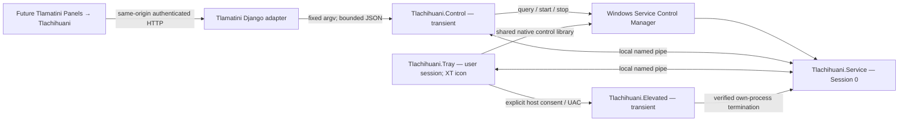

# Architecture

Implementation update: [current status and remaining gates](implementation-status.md) supersede any scaffold-only statements below. This document retains the full planned architecture.

Design proposal, 2026-10-11. No components are implemented.

## Process model

The service continues when no browser is open, Tlamatini is closed, the tray exits, or the user logs off. The tray only exists in participating interactive sessions. Windows isolates service UI from the user's desktop; a separate session process is required. This split follows [Microsoft's interactive-services guidance](https://learn.microsoft.com/en-us/windows/win32/services/interactive-services).

## Recommended stack

Use C# with .NET 10 for the independent Windows layer: a Worker Service host, native SCM integration, WinForms `NotifyIcon`, and a small shared control client. This fits the Windows lifecycle and tray requirements while a language-neutral JSON bridge keeps Tlamatini's Python integration small. The alternative Python/pywin32 stack could reuse developer familiarity, but would carry a second Python packaging/runtime surface for a Windows-only companion. The .NET choice is a proposal to implement here, not an installed dependency.

Follow [Microsoft's Worker Service guide](https://learn.microsoft.com/en-us/dotnet/core/extensions/windows-service) and [NotifyIcon documentation](https://learn.microsoft.com/en-us/dotnet/desktop/winforms/controls/notifyicon-component-overview-windows-forms). Pin supported SDK and package patch versions at implementation. Prefer self-contained win-x64 deployment for initial releases, subject to measured size/startup testing; ARM64 is a later explicit target. Do not download an SDK or NuGet packages just to prepare this scaffold.

## Component responsibilities

| Planned directory | Responsibility |
|---|---|
| `src/Tlachihuani.Contracts` | Versioned DTOs, operation/error vocabulary, validators; no Windows or UI dependency |
| `src/Tlachihuani.Core` | Lifecycle/health state, cancellation, bounded event history, workload interface |
| `src/Tlachihuani.Windows` | SCM calls, service/process identity checks, ACLs, installation discovery, native errors |
| `src/Tlachihuani.Service` | Windows service host, IPC server, heartbeat, diagnostic sinks, later workload composition |
| `src/Tlachihuani.Client` | Typed pipe client, deadlines, version negotiation; shared by tray/controller |
| `src/Tlachihuani.Control` | Short-lived JSON CLI used by Tlamatini; start/status/stop even when service is down |
| `src/Tlachihuani.Tray` | One XT icon per participating Windows session, status/menu, open Tlamatini |
| `src/Tlachihuani.Elevated` | Fixed-service force-stop and other explicitly scoped administrative operations |

Core and Contracts do not import Service, Tray, or Tlamatini. The service contains no desktop automation, microphone capture, browser host, model integration, or arbitrary process launcher in the foundation release. Future workloads are cancellable implementations behind a narrow Core interface, with their privileges evaluated separately.

## Ownership and persistence

Proposed installed layout: `%ProgramFiles%\XAIHT\Tlachihuani` for administrator-owned binaries; `%ProgramData%\XAIHT\Tlachihuani` for ACL-protected configuration, logs, and state; `%LOCALAPPDATA%\XAIHT\Tlachihuani` for per-user tray preferences. Resolve Windows known folders rather than assuming drive C at runtime. These are distinct from the requested source checkout.

SCM starts the service independently. Do not launch it under Tlamatini's agent pool or inherit `TLAMATINI_AGENTS_ROOT`. The tray starts from a per-user logon entry created by its own installer. Neither resident process belongs in Tlamatini's subprocess tree, updater deletion set, or orphan-reaper registry. Short-lived controllers may be Tlamatini children; terminating them must not terminate the service.

Use UTC timestamps in machine contracts and local time for user display. Structured logs carry instance/request IDs and result codes, never credentials, model context, or Tlamatini chat contents. No shared SQLite database is needed. Retention and health intervals are configurable within validated bounds; proposed defaults are in the lifecycle document.
