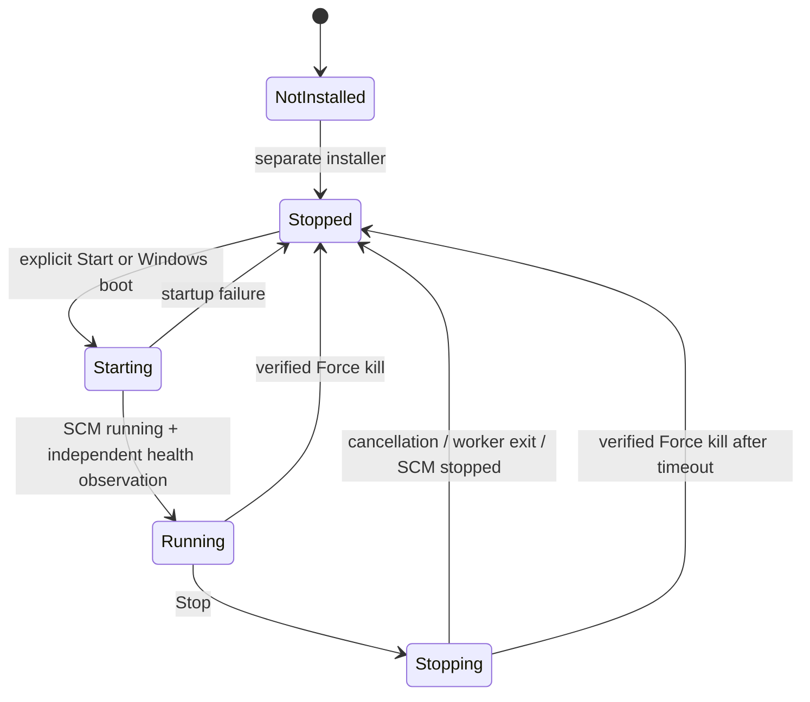

# Service lifecycle

Implementation update: Start/Stop/Restart and monitoring are implemented; force-stop/host consent and installed acceptance remain pending. See [current status](implementation-status.md).

All values here are proposed defaults. SCM observations and worker health are separate facts.

## States

SCM state is one of `not_installed`, `stopped`, `start_pending`, `running`, `stop_pending`, `paused`, `pause_pending`, `continue_pending`, or `unknown`. Preserve native codes when an unexpected state is encountered; the initial product does not offer pause/resume.

Application health is separately `unknown`, `initializing`, `healthy`, `degraded`, or `unresponsive`. A process in SCM RUNNING with an unreachable pipe is **Running · health unavailable**, never Stopped. A disconnected Tlamatini browser says Connection unavailable and retains a visibly stale timestamp. It must not claim the service crashed.

## Operation semantics

| Action | Behavior and completion evidence |
|---|---|
| Start / raise | Request SCM start for the fixed installed service. Already running is an idempotent success. Wait through pending states; show initializing until health is ready. Never install on Start. |
| Monitor | Query SCM independently, then request bounded pipe status if running. Include freshness, instance, version, uptime and last error. |
| Stop | Send the normal SCM stop. Cancel work, stop accepting jobs, flush bounded diagnostics, dispose IPC and finish. Already stopped is success. |
| Restart | Optional convenience: complete Stop, then Start under the same serialized operation. No implicit force kill on timeout. |
| Force kill | Explicit destructive action after confirmation. Verify current SCM-owned process identity and terminate that instance through the administrative helper. Observe process exit and SCM STOPPED. No `taskkill /IM`, guessed PIDs, or arbitrary child sweep. |

Use one cross-process serialized lifecycle operation per installation so multiple tabs/trays cannot race Start/Stop/Kill. Status remains available while an operation runs. Duplicate request IDs return the existing operation outcome. Reusing a request ID with a different action is a conflict. Persist minimal completion receipts so controller exits do not lose the result.

## Deadlines and recovery

Proposed budgets: pipe connection 2 s, status response 3 s, control request acceptance 5 s, start 30 s, graceful stop 30 s. Observe SCM checkpoint/wait-hint changes within an overall bounded deadline. UI polling is 2 s while the dialog is open and visible; hidden/closed views stop polling. The Django adapter coalesces reads with a 1 s host cache so tabs do not create a process storm.

The service increments a heartbeat every 2 s; a health observation older than 10 s becomes stale. The tray reconnects with bounded backoff up to 30 s and immediately retries on user Refresh. These thresholds must be tested under sleep/resume and load, and do not authorize automatic termination.

First-release startup mode: **Automatic (Delayed Start)** after an explicit installation. Stop/Force kill keep it stopped for the remainder of the boot; the panel explains it will start on the next boot. SCM failure restart actions are **disabled initially**, preventing kill from immediately respawning the service. Any future crash-restart feature needs an intentional-stop suppression design and separate tests before enabling it.

A stop timeout offers retry/status/Force kill; it never silently escalates. A failed startup records the actual Windows error and bounded service error. Failure to measure health is not success. Failed or refused termination must leave the UI reporting the observed live state.

## Tray lifecycle

Use a session-scoped single-instance mutex and a stable icon identity. Initialize the message loop, register the original XT icon, and re-register it after Explorer's `TaskbarCreated` notification. Dispose the icon on normal exit. Windows may place it in the notification overflow; do not rewrite the user's notification preferences to force pinning.

The tray does not auto-start the service just because it starts or reconnects. Exiting it leaves the service untouched. The service does not need a tray to operate. Tray presence is reported per session; an absent heartbeat means unavailable, not proof that a user can or cannot see an icon.
